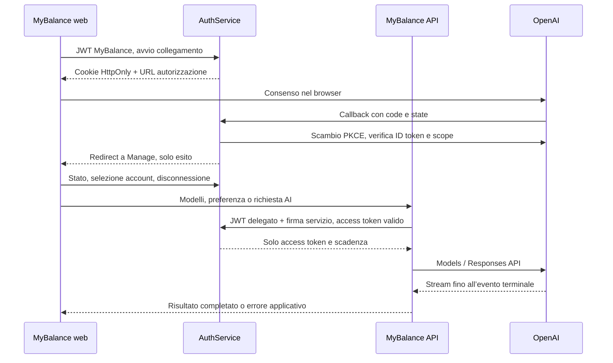

# Integrazione del piano ChatGPT

Implementazione: 18 ottobre 2026. Stato: codice implementato; attivazione hosted e smoke test
OpenAI subordinati al provisioning del client e all’approvazione dell’uso del piano.

Vincolo funzionale: l’accesso all’app continua con Google. OAuth ChatGPT autorizza l’uso del
piano per l’account MyBalance già autenticato e associa le credenziali a quell’account.
L’identità OpenAI verifica il proprietario della connessione e non diventa un metodo di login
MyBalance. Collegamento, disconnessione o cambio account ChatGPT non cambiano l’account Google.

## Architettura

AuthService gestisce identità esterna, credenziali cifrate, rinnovo e revoca. MyBalance API
gestisce catalogo modelli, preferenza e inferenza. Il collegamento richiede una sessione
MyBalance esistente e non crea utenti né emette nuove sessioni applicative.

## Funzionalità implementate

- Dashboard desktop → logo MyBalance → Manage → Integrazioni AI → ChatGPT. Componente condiviso
  con Settings per la route web portrait.
- Stato di disponibilità, aggiunta di account, account attivo, riconnessione e disconnessione.
- Etichette distinte per registrazioni con la stessa email, usando l’ID della connessione.
- Ritorno dal consenso alla schermata Manage, messaggi di esito e conferma al primo uso del piano.
- Catalogo per account, preferenza modello persistente e richiesta di prova esplicitamente avviata.
- Nessun token OpenAI nelle risposte pubbliche, nel browser o nei JWT MyBalance.
- Errori di integrazione distinti dal 401 della sessione MyBalance; nessun fallback a billing API key.

## OAuth e credenziali

Il client hosted registrato è configurato sul server. Il flusso usa PKCE S256, nonce e state
casuali. Il tentativo è salvato in Postgres con verifier cifrato, digest del cookie browser,
sessione originaria, client, redirect esatto, scadenza di dieci minuti e consumo atomico.
Un nuovo tentativo sostituisce quello precedente dello stesso utente/prodotto.

Il callback controlla cookie HttpOnly, sessione ancora valida, client ID, firma JWKS dell’ID
token, issuer, audience, exp, iat, nonce e identità dell’account selezionato per la riconnessione.
Solo gli scope del token endpoint consentono l’inferenza. Identità valida senza permesso
produce `permission_required`, senza sostituire il login MyBalance.

Le chiavi JWKS e la discovery sono memorizzate in cache; un `kid` sconosciuto forza il recupero
delle chiavi. Gli endpoint scoperti devono restare sotto `https://auth.openai.com`. Il client
usa `none` o `client_secret_basic` secondo il provisioning; un secret non viene inviato nel body.

AuthService conserva il payload cifrato AES-256-GCM con access, refresh e ID token, insieme a
scope, scadenza e soglia di rinnovo. Ogni registrazione è distinta per utente, prodotto,
issuer, subject e client ID. L’email è una sola etichetta. Un lock Postgres per utente/prodotto
serializza collegamento, selezione, refresh e disconnessione anche tra processi.

Il refresh sostituisce atomicamente credenziali e metadati. Errori temporanei conservano la
sessione recuperabile; errori terminali cancellano i token inutilizzabili e producono
`reauth_required`. Una disconnessione concorrente non può essere annullata da un refresh.

La revoca usa l’endpoint della discovery. Su errore si disattiva subito l’uso della connessione,
si conserva solo il refresh token cifrato necessario al retry e si mostra `revocation_pending`.
L’utente può riprovare la revoca o usare le impostazioni ChatGPT. La mappatura account/client
rimane disponibile dopo la disconnessione.

## API

Tutti i percorsi pubblici sotto richiedono il JWT MyBalance, tranne il callback OAuth.

| Servizio | Metodo e percorso | Uso |
| --- | --- | --- |
| AuthService | `GET /integrations/chatgpt/status` | Disponibilità e DTO delle connessioni |
| AuthService | `POST /integrations/chatgpt/authorize` | Nuovo account o riconnessione con `connectionId` |
| AuthService | `GET /integrations/chatgpt/callback` | State, cookie e codice di autorizzazione |
| AuthService | `POST /integrations/chatgpt/connections/:id/select` | Account attivo |
| AuthService | `POST /integrations/chatgpt/connections/:id/acknowledge` | Conferma primo utilizzo |
| AuthService | `DELETE /integrations/chatgpt/connections/:id` | Disconnessione e revoca, ripetibile |
| AuthService, interno | `POST /internal/integrations/chatgpt/access-token` | Access token per il servizio e la sessione verificati |
| MyBalance API | `GET /integrations/chatgpt/models?connectionId=UUID` | Catalogo e modello preferito |
| MyBalance API | `PUT /integrations/chatgpt/preferences` | Salva `{connectionId, model}` validato sul catalogo |
| MyBalance API | `POST /integrations/chatgpt/responses` | `{connectionId, model, prompt}` → `{connectionId, model, outputText}` |

Il browser usa `HttpHelper.authUri` per le operazioni OAuth e `HttpHelper.endpointUri` per le
operazioni AI. La vecchia route di stato nell’API MyBalance è stata rimossa.

L’endpoint interno richiede una firma HMAC con secret condiviso di almeno 32 caratteri,
timestamp, ID richiesta, metodo, percorso, digest body e digest del JWT delegato. La finestra
temporale è di un minuto e il database impedisce il replay tra istanze. AuthService verifica
anche sessione, prodotto MyBalance e proprietà della connessione. Un JWT browser da solo non
permette di recuperare token. Refresh e ID token non vengono mai consegnati all’API MyBalance.

## Inferenza

Il catalogo usa `models`, `visibility`, `display_name` e `slug` del percorso SIWC. Il modello
viene validato sull’account anche prima dell’inferenza. La preferenza resta in MyBalance,
separata dalle credenziali di AuthService.

Le richieste vanno solo a `https://api.openai.com/v1/responses`, con `store:false`, `stream:true`
e input testuale esplicito. Il server consuma SSE, gestisce chunk UTF-8/frame parziali, limiti di
dimensione, timeout e cancellazione. Restituisce successo solo su `response.completed`;
fallimento, incompletezza e interruzione non restituiscono testo parziale come risposta riuscita.
Gli errori di quota e permesso possono arrivare anche dopo il primo delta e vengono propagati
come errori di integrazione. I dettagli diagnostici pubblici includono status provider e request ID
quando disponibili, senza token o body sensibili.

La prova invia soltanto una breve richiesta di conferma: non allega automaticamente dati finanziari.
L’endpoint Responses implementato accetta testo e modello; ulteriori feature multimodali o tool
richiedono un’estensione esplicita conforme al grant approvato.

## Limite esterno e attivazione

La documentazione pubblica distingue il client web registrato dal flusso OSS con registrazione
dinamica e callback loopback. Questa implementazione usa il client web registrato: non usa
`dynamic_agent_client` e non importa sessioni locali sul backend condiviso.

Il grant hosted per il piano deve essere confermato da OpenAI, inclusi scope, resource,
metodo di autenticazione e disponibilità degli endpoint. I default di scope corrispondono al
contratto Responses documentato pubblicamente; non sono prova di abilitazione del client hosted.
Se OpenAI fornisce un contratto differente, adattare il provider prima dell’attivazione.

La configurazione richiede sia `CHATGPT_ENABLED=true` sia `CHATGPT_PLAN_USAGE_APPROVED=true`.
Senza approvazione o parametri validi, lo stato è indisponibile e il pulsante rimane disabilitato.
Vedere [runbook](CHATGPT_INTEGRATION_RUNBOOK.md) per migrazioni, configurazione e smoke test.

Riferimenti verificati il 18 ottobre 2026:

- [Website OAuth](https://developers.openai.com/siwc/website)
- [Disponibilità del piano](https://developers.openai.com/siwc/token-sharing-open-source)
- [Token e sessioni](https://developers.openai.com/siwc/token-sharing-open-source/profiles-and-sessions)
- [Modelli e Responses](https://developers.openai.com/siwc/token-sharing-open-source/models-and-inference)
- [Limitazioni](https://developers.openai.com/siwc/token-sharing-open-source/preview-limitations)
- [Errori](https://developers.openai.com/siwc/token-sharing-open-source/errors-and-recovery)
- [Linee guida UI](https://developers.openai.com/siwc/ui-ux-guidelines)
